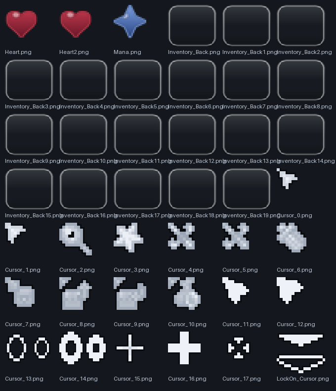

<div align="center">


# Arima-UI Terraria

**Тёмное стекло вместо стандартного интерфейса Terraria.**

[](https://www.tmodloader.net/)
[](https://terraria.org/)
[](#установка)
[](LICENSE)

</div>

---

## Что это

Полная замена внешнего вида интерфейса Terraria в стиле «liquid glass»: тёмное стекло,
мягкие скругления, объёмные pill-кнопки, кромка в 1 px и приглушённый мир под открытыми
панелями. Мелкий текст остаётся резким — прозрачность только у подложки.

Проект состоит из двух частей, они работают вместе:

| Артефакт | Что внутри |
|---|---|
| `release/TerrariaUI.tmod` | мод: стеклянная панель под инвентарём, затемнение фона, анимации появления, полоса HUD, дизайн-лаборатория |
| `release/Arima-UI Terraria.zip` | ресурспак: все текстуры — меню и настройки, тултипы, чат, слоты инвентаря, сердца, мана, курсоры, полосы HUD |

Мод ничего не пишет в `TextureAssets`. Это принципиальное решение: при перезагрузке моды
tModLoader освобождает ассеты мода, а ваниль продолжает на них ссылаться — игра падает
с `NullReferenceException` в отрисовке. Поэтому все замены текстур лежат в ресурспаке,
которым владеет сама игра.

## Что меняется

- **Инвентарь** — стеклянная панель, слоты 44 px с кромкой и бликом, скрим под интерфейсом.
- **Меню и настройки** — тёмные пластины вместо деревянных, новые кнопки, переключатели,
  ползунки, скроллбары и вкладки.
- **HUD** — перерисованы сердца, мана и полосы; опционально стеклянная полоса вместо них.
- **Тултипы и чат** — стеклянные подложки вместо бумажных.
- **Курсоры** — 18 вариантов, кольцо захвата цели и радиальное меню.

## Как это выглядит


<table>
<tr>
<td></td>
<td></td>
</tr>
</table>

<details>
<summary>Ещё: дизайн-борды и отдельные элементы</summary>

<table>
<tr>
<td></td>
<td></td>
</tr>
<tr>
<td></td>
<td></td>
</tr>
</table>

</details>

## Установка

1. `release/TerrariaUI.tmod` → `Documents\My Games\Terraria\tModLoader\Mods`
2. `release/Arima-UI Terraria.zip` → `Documents\My Games\Terraria\ResourcePacks`
3. Запустить tModLoader и включить мод **Arima-UI Terraria**, затем Reload
4. В главном меню: `Workshop → Resource Packs`, перенести пак в правую колонку
5. Перезапустить игру — пак читается только при загрузке

С GitHub архив скачивается как `Arima-UI.Terraria.zip` — площадка меняет пробел на точку.
Файл тот же: имя пака берётся из `pack.json`, поэтому в списке ресурспаков он называется
«Arima-UI Terraria».

Порядок важен: сначала мод, потом пак. Если пак отключён, панели и HUD останутся
стеклянными, а текстуры меню и слотов — ванильными.

Подробности и таблица «симптом → причина» — в [docs/INSTALL.md](docs/INSTALL.md).

## Настройка

`Settings → Mod Config → Arima-UI Terraria`. Подписи на русском и английском.

**Стекло**

| Параметр | Что делает |
|---|---|
| `Плотность панели` | насколько плотное стекло, 0.05–1 |
| `Цвет стекла` | базовый цвет панелей, с пикером |
| `Цвет слотов`, `Прозрачность слотов` | подложки слотов |
| `Акцентный цвет` | главные кнопки, ползунки, кольцо выбора |
| `Цвет текста`, `Приглушённый текст` | заголовки и вторичные подписи |
| `Яркость кромки`, `Сила блика` | «дороговизна» материала |
| `Реальное размытие`, `Сила размытия` | размытие мира за панелями |
| `Затемнение фона` | скрим под открытым интерфейсом, 0 — выключить |

**HUD**

| Параметр | Что делает |
|---|---|
| `Стеклянная полоса HUD` | свой бар здоровья и маны вместо сердец |
| `Край HUD` | правый край, как в ванили, или левый |
| `HUD — отступ X`, `HUD — отступ Y` | положение полосы |
| `Ширина полосы HUD` | длина полосы |

**Раскладка инвентаря**

| Параметр | Что делает |
|---|---|
| `Панель — X`, `Панель — Y` | положение подложки под инвентарём |
| `Ширина панели`, `Высота панели` | размеры подложки |

Раскладку приходится подгонять вручную: геометрия ванильного инвентаря зависит от
`Main.UIScale` и разрешения. Как калибровать — [docs/LAYOUT.md](docs/LAYOUT.md).

**Отладка**

| Параметр | Что делает |
|---|---|
| `Отладочный оверлей` | разрешение, масштаб UI и линейка |
| `Дизайн-лаборатория` | все компоненты системы на одном экране |
| `Дамп ванильных ассетов` | сохраняет ванильные UI-текстуры в папку сохранений |

## Структура репозитория

```
TerrariaUI/   исходники мода: C#, ассеты, локализация, конфиг
docs/         дизайн-система, метрики текстур, установка, сборка
release/      собранные артефакты: .tmod и ресурспак
```

## Сборка

Нужны tModLoader 2026.09 и .NET SDK 8.0 или новее.

```powershell
$env:TML_PATH = "C:\Program Files (x86)\Steam\steamapps\common\tModLoader"
cd TerrariaUI

dotnet build -c Release                     # компиляция и упаковка .tmod в Mods
dotnet build -c Release -p:BuildMod=false   # только проверка компиляции
```

`TML_PATH` нужен, только если игра стоит не в стандартной папке Steam.
Упаковка не работает, пока tModLoader запущен — закройте игру или собирайте
через `Develop Mods → Build + Reload`. Линт и проверка ассетов —
[docs/BUILD.md](docs/BUILD.md).

## Документация

| Файл | О чём |
|---|---|
| [docs/DESIGN.md](docs/DESIGN.md) | дизайн-система: токены, компоненты, premultiplied-альфа, антипаттерны |
| [docs/UI-INVENTORY.md](docs/UI-INVENTORY.md) | реальные размеры ванильных UI-текстур |
| [docs/LAYOUT.md](docs/LAYOUT.md) | как попадаем в координаты UI и как калибровать |
| [docs/INSTALL.md](docs/INSTALL.md) | установка, порядок включения, разбор симптомов |
| [docs/BUILD.md](docs/BUILD.md) | сборка, упаковка, линт |
| [docs/CHANGELOG.md](docs/CHANGELOG.md) | журнал изменений и известные ограничения |

## Лицензия

MIT — см. [LICENSE](LICENSE). Код и текстуры мода написаны с нуля; Terraria и её
оригинальные ассеты принадлежат Re-Logic. Репозиторий не содержит ванильных ресурсов.
