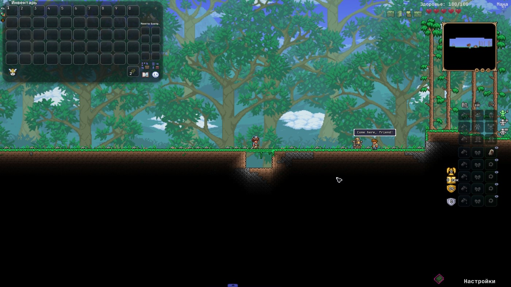
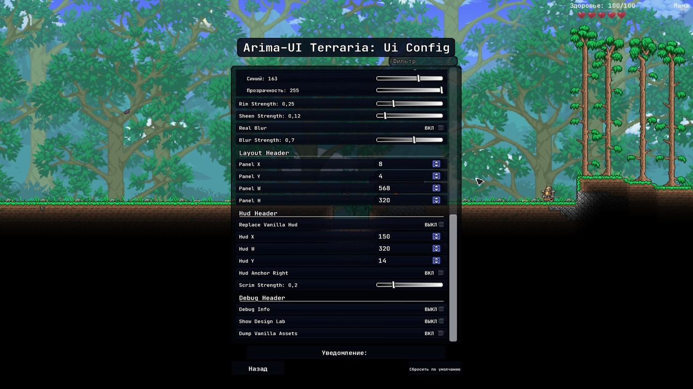
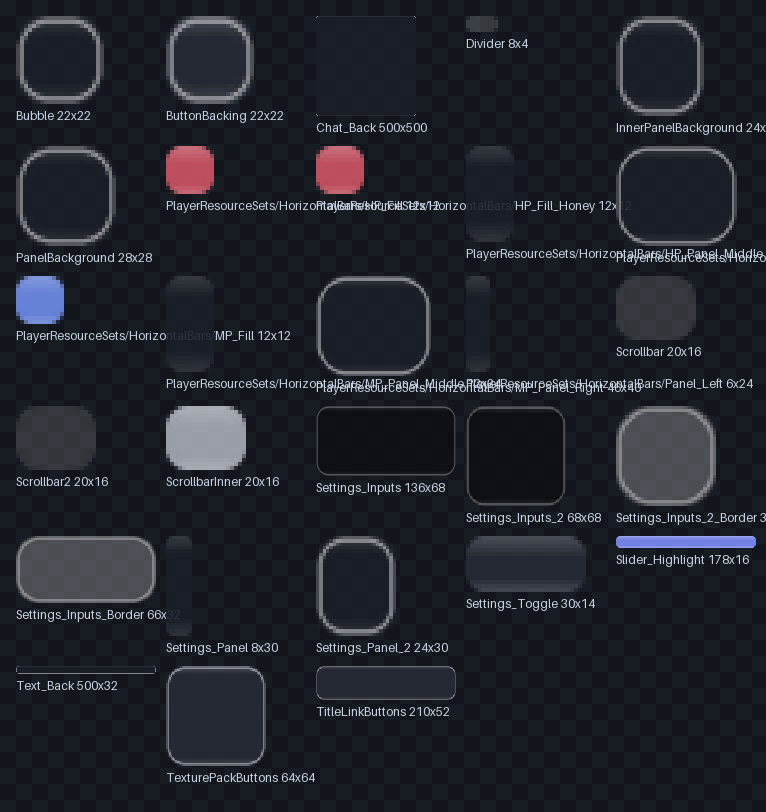
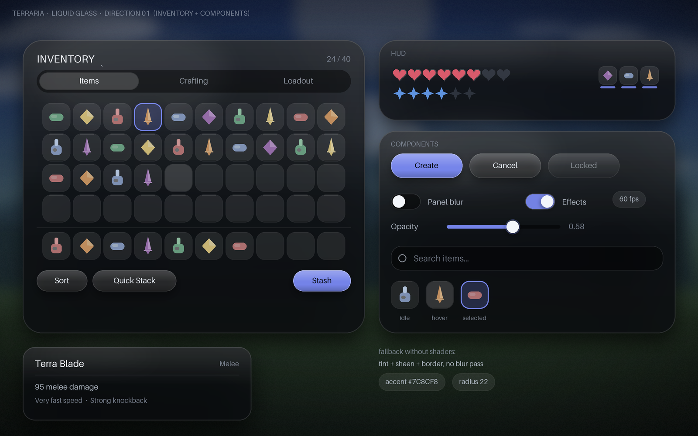
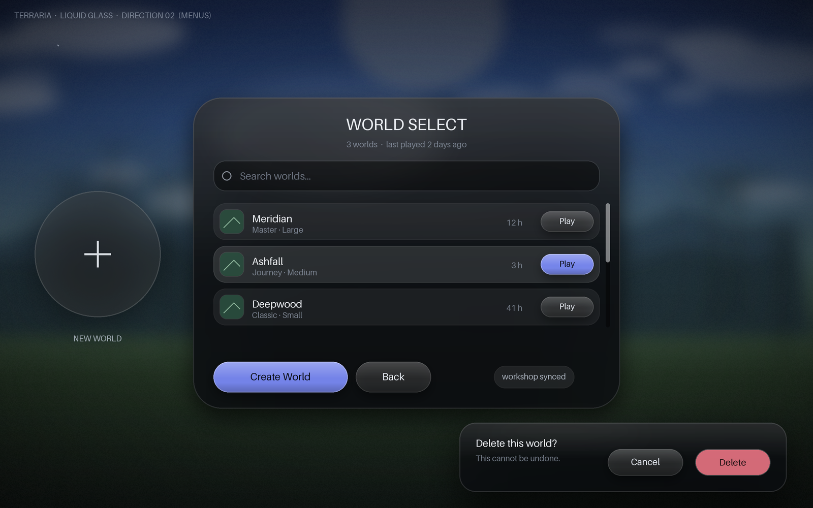
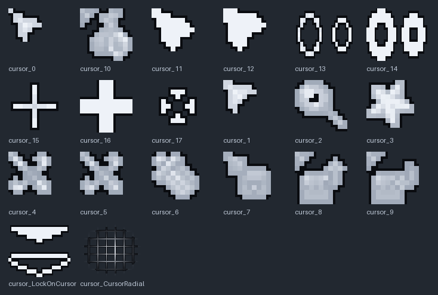

<div align="center">


# Arima-UI Terraria

Автор: **Arima**

**Интерфейс в тёмном стекле: панели, слоты, HUD, меню.**

[](https://www.tmodloader.net/)
[](https://terraria.org/)
[](#-english)
[](#)

</div>

---

## Что это

Полная замена внешнего вида интерфейса Terraria в стиле «liquid glass»: тёмное стекло,
мягкие скругления, объёмные pill-кнопки, приглушённый фон под открытыми панелями.

Два артефакта, работают вместе:

| | Что делает |
|---|---|
| **мод** (`release/TerrariaUI.tmod`) | стеклянная панель под инвентарём, затемнение фона, анимации появления, опциональная полоса HUD, дизайн-лаборатория |
| **ресурспак** (`release/Arima-UI Terraria.zip`) | все текстуры: меню и настройки, создание мира/персонажа, тултипы, чат, слоты, сердца и мана, курсоры, полосы HUD |

Мод не трогает `TextureAssets` — это принципиально: подмена ассетов ломается при Reload,
потому что tModLoader освобождает ассеты мода, а ваниль продолжает на них ссылаться.
Все замены текстур живут в ресурспаке, которым владеет игра.

## Как это выглядит



<table>
<tr>
<td></td>
<td></td>
</tr>
</table>

<details>
<summary>Дизайн-борды (как проектировалось)</summary>

<table>
<tr>
<td></td>
<td></td>
</tr>
</table>

</details>

## Установка

1. `TerrariaUI.tmod` → `Documents\My Games\Terraria\tModLoader\Mods`
2. `Arima-UI Terraria.zip` → `Documents\My Games\Terraria\ResourcePacks`
3. Запустить tModLoader → включить мод **Arima-UI Terraria** → Reload
4. Главное меню → Workshop → Resource Packs → перенести пак вправо
5. Перезапустить игру (пак читается при загрузке)

Подробнее — [docs/INSTALL.md](docs/INSTALL.md).

## Настройка

`Settings → Mod Config → Arima-UI Terraria`. Всё на русском и английском.

| Параметр | Зачем |
|---|---|
| `Плотность панели` | насколько плотное стекло |
| `Цвет стекла`, `Акцентный цвет`, `Цвет текста` | палитра в рантайме, с пикером |
| `Яркость кромки`, `Сила блика` | «дороговизна» материала |
| `Затемнение фона` | скрим под интерфейсом; 0 — выключить |
| `Стеклянная полоса HUD`, `Край HUD`, `отступы X/Y`, `Ширина полосы` | свой бар вместо сердец |
| `Панель — X/Y`, `Ширина/Высота панели` | подгонка под раскладку других модов |

## Структура репозитория

```
TerrariaUI/     исходники мода (C#, ассеты, локализация)
docs/           дизайн-система, метрики ассетов, установка, журнал изменений
release/        собранные артефакты: .tmod и ресурспак
```

<table>
<tr>
<td></td>
<td></td>
</tr>
</table>

## Сборка

Нужен tModLoader 2026.09 и .NET SDK.

```powershell
cd TerrariaUI
dotnet build -c Release                 # компиляция + упаковка .tmod в Mods
dotnet build -c Release -p:BuildMod=false   # только проверка компиляции
```

Путь к установке переопределяется: `-p:TMLPath="C:\...\tModLoader"`.

## Документация

| Файл | О чём |
|---|---|
| [docs/DESIGN.md](docs/DESIGN.md) | дизайн-система: токены, компоненты, premultiplied-альфа, антипаттерны |
| [docs/UI-INVENTORY.md](docs/UI-INVENTORY.md) | реальные размеры ванильных UI-текстур |
| [docs/LAYOUT.md](docs/LAYOUT.md) | как попадаем в координаты UI и как калибровать |
| [docs/CHANGELOG.md](docs/CHANGELOG.md) | журнал изменений и известные ограничения |

---

## English

A dark "liquid glass" reskin of the Terraria interface: translucent rounded panels with a 1 px
rim, moulded pill buttons, a dimmed backdrop behind open screens, a glass HUD, glass slots and a
recoloured cursor set.

Two artefacts: the **mod** (`release/TerrariaUI.tmod`) draws the panels, backdrop and HUD bar;
the **resource pack** (`release/Arima-UI Terraria.zip`) replaces every texture — menus, world and
character creation, tooltips, chat, slots, hearts, mana, cursors and HUD bars.

The mod never writes into `TextureAssets`: mod assets are disposed on reload while vanilla keeps
pointing at them, which crashes the game. All texture replacements live in the pack.

Install: put the `.tmod` into `tModLoader/Mods`, the `.zip` into `Terraria/ResourcePacks`, enable
both, restart the game. Details in [docs/INSTALL.md](docs/INSTALL.md).

## Лицензия

MIT — см. [LICENSE](LICENSE). Terraria и её ассеты принадлежат Re-Logic; репозиторий не содержит
ванильных ресурсов, только собственные перерисовки.
